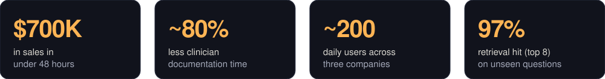
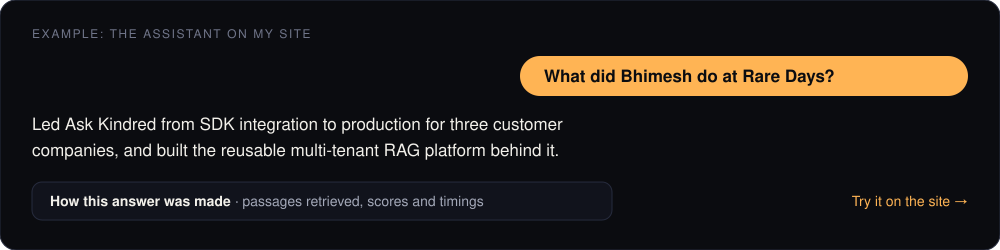

  

  <a href="https://bhimeshchauhan.com/"><b>Portfolio</b></a> &nbsp;·&nbsp;
  <a href="https://bhimeshchauhan.com/evidence/"><b>Evidence</b></a> &nbsp;·&nbsp;
  <a href="https://www.linkedin.com/in/bhimeshchauhan"><b>LinkedIn</b></a> &nbsp;·&nbsp;
  <a href="mailto:bhimeshchauhan@gmail.com"><b>Email</b></a>

I build and run production RAG and LLM systems end to end, from retrieval architecture to launch-day reliability, and lead the teams around them. Currently Lead Software Engineer at Rare Days. I have lived and worked in Canada, the United States and Spain.

## Activity

Every day I contributed since 2017, one star each: the field gets denser as the work does. Private-repository work is counted but never named.

**[Explore it on my site](https://bhimeshchauhan.com/activity/)**: hover or tap any star for its date and count.

## Selected work

Most of my recent work is client or private, so the write-ups live on my site:

- **[Ask Kindred](https://bhimeshchauhan.com/case-studies/ask-kindred/)**: production RAG assistant serving about 200 daily users across three customer companies.
- **[RareDaysAI](https://bhimeshchauhan.com/case-studies/raredays-ai-platform/)**: the reusable multi-tenant RAG platform behind it, shipped as an npm SDK and CLI.
- **[Scrubs Co-Pilot](https://bhimeshchauhan.com/case-studies/scrubs-copilot/)**: ambient clinical AI that cut clinician documentation time by about 80%.
- **[Jefferson Fisher launch](https://bhimeshchauhan.com/case-studies/jefferson-fisher/)**: about $700K in sales in under 48 hours.

## Ask it yourself

My site has an assistant that answers from a search index of my work, and it shows what it retrieved. I measure that retrieval and publish the misses on the **[Evidence page](https://bhimeshchauhan.com/evidence/)**.

## Open source here

- **[bhimeshchauhan.github.io](https://github.com/bhimeshchauhan/bhimeshchauhan.github.io)**: my portfolio, with its RAG assistant, the retrieval check (`backend/scripts`) and the indexer.
- **[RAG-based-llm-Assistant-comparison](https://github.com/bhimeshchauhan/RAG-based-llm-Assistant-comparison)**: a side-by-side comparison of CustomGPT, Botpress and a Pinecone-backed RAG build.
- **[Audible](https://github.com/bhimeshchauhan/Audible)**: extracts characters from a book PDF with NER and builds a relationship graph, toward audiobook narration.
- **[dataroom](https://github.com/bhimeshchauhan/dataroom)**: a virtual data room app (React, TypeScript, Flask, PostgreSQL).

## Stack

Outside work I sketch and play music. Some of it is on [my site](https://bhimeshchauhan.com/art/).
